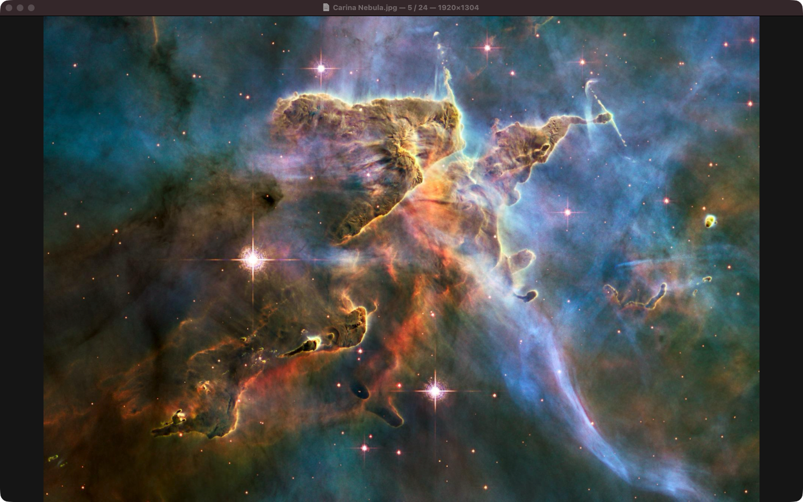
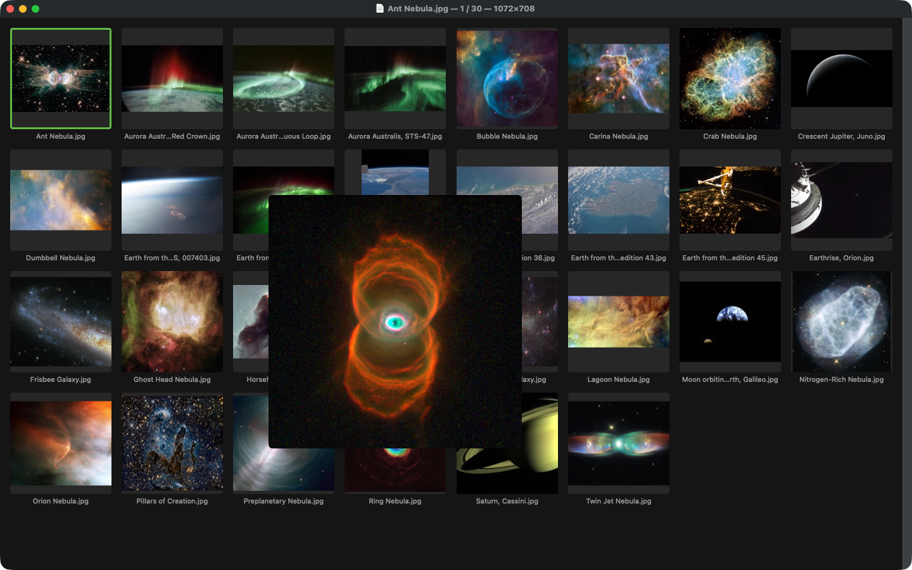
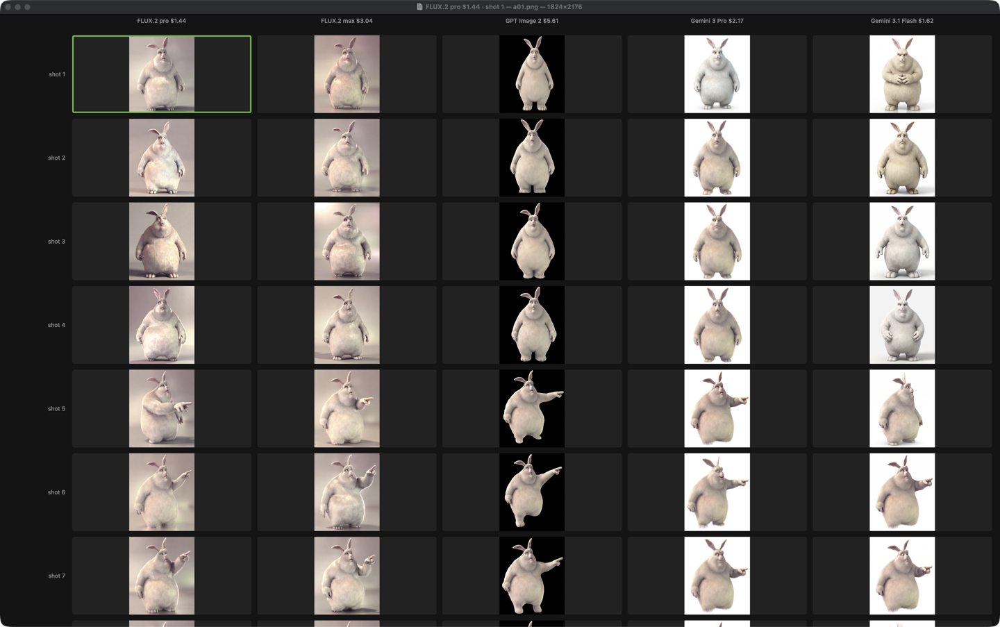

# glance

[](https://github.com/lockyc/glance/releases/latest)


[](LICENSE)

Arrow through a folder of images as fast as the disk allows. Open any image and ←/→ steps
through the rest of its folder; G swaps in a thumbnail grid for jumping around. Turn on Include
Subfolders and years of screenshots become one stream, oldest first. Hand it labelled groups of
files and it lays them out side by side for comparing. If you've used Xee, it's the same idea.



## Install

```bash
curl -fsSL https://raw.githubusercontent.com/lockyc/glance/main/install.sh | bash
glance --make-default   # optional: the default viewer for every image type except PDF
```

Needs macOS 14 or later. The installer downloads the latest release, checks that it is signed by
glance's developer and notarized by Apple, installs `/Applications/glance.app` and links the
`glance` command into `~/.local/bin`, which must be on your PATH. glance then updates itself: it
checks daily, and **glance → Check for Updates…** checks now.

To build from source instead (needs the Xcode command-line tools with Swift 6, and
[`just`](https://github.com/casey/just)):

```bash
git clone https://github.com/lockyc/glance && cd glance
just install        # builds glance.app into /Applications and links `glance` into ~/.local/bin
just make-default   # optional, as --make-default above
```

## Features

- **The viewer.** Opening a file shows it in its folder; ←/→ step through the rest, wrapping at
  the ends. Zoom about the cursor with a pinch or ⌘-scroll, and drag a fitted image out to
  another app.
- **The grid.** Opening a folder, or dropping one on the Dock icon, opens a full-window
  thumbnail grid; hovering a tile shows it enlarged. Select several tiles to copy them, show them
  in Finder or edit them together.

  

- **Subfolders.** **View → Include Subfolders** turns a folder and everything under it into one
  stream, oldest first, with month headers in the grid. Opening any file inside it opens the
  whole tree at that file. Exclude individual subfolders from **View → Subfolders** or
  **glance → Settings…**.
- **Sets and comparisons** — from the command line:

  ```bash
  glance <folder>                                  # open a folder
  glance <file>...                                 # open the files as a set
  glance --variant <label> <file>... [--variant <label> <file>...]...
                                                   # compare labelled variants side by side
  glance --link <any of the above>                 # print a glance:// link instead of opening
  ```

  A set is the files you name, in that order. A comparison makes each `--variant` a column and
  each of its files a row, so the first file of every variant sits on the first row. Opening a
  cell keeps every variant's label along the top and every shot down the left, with a map of the
  grid in the corner; click a label or a map cell to jump there. Each set or comparison opens in
  a new window. A `--link` link reopens the same view when clicked in a note, a doc or a chat.

  

  <sub>Model renders adapted from Big Buck Bunny © Blender Foundation, [CC BY 3.0](https://creativecommons.org/licenses/by/3.0/).</sub>

- **Formats.** Everything ImageIO decodes — JPEG, PNG, HEIC/HEIF, WebP, AVIF, JPEG XL, TIFF, BMP,
  GIF, ICO, ICNS, PSD, OpenEXR, TGA and camera RAW (CR2, CR3, NEF, ARW, RAF, ORF, DNG and more) —
  plus SVG. Animated GIF, WebP and APNG play.
- **Edit in [Excerpt](https://github.com/lockyc/excerpt)** (E): hands the PNG in view, or the
  grid's selection as one series, to the screenshot editor.

### Keys

**Viewer**

| Key | Action |
|---|---|
| ← / → | Previous / next image (wraps) |
| Home / End | First / last image |
| G or Space | Thumbnail grid |
| F or ⌃⌘F | Toggle full screen |
| Esc | Leave full screen, otherwise thumbnail grid |
| E or ⌘E | Edit in Excerpt (PNG only) |
| ⌘C | Copy the image (pastes as the file, or as a picture) |
| ⌘R | Show in Finder |
| ⌘↑ | Browse the image's folder (from a set or comparison) |
| Right-click | Browse Folder, Show in Finder, Edit in Excerpt, Copy |
| 0 / 1 | Fit to window / actual size |
| + / − | Zoom in / out |
| Pinch or ⌘-scroll | Zoom about the cursor |
| Drag, or scroll when zoomed | Pan |
| Drag when fitted | Drag the image out to another app |
| Double-click | Toggle fit ↔ actual size |

**Grid**

| Key | Action |
|---|---|
| ← / → | Select the previous / next tile (across months) |
| ↑ / ↓ | Move the selection by row |
| Return or click | Open the image |
| ⌘-click / ⇧-click | Select several tiles |
| E or ⌘E | Edit the selected images in Excerpt, as one series (PNG only) |
| ⌘C | Copy the selected images |
| ⌘R | Show the selected images in Finder |
| ⌘↑ | Browse the selected image's folder (from a set or comparison) |
| Right-click | The same commands, on the clicked tile |
| Esc, G or Space | Back to the viewer |
| ⌘+ / ⌘− | Larger / smaller tiles (remembered) |
| Hover | Enlarged preview |

**Comparison**

| Key | Action |
|---|---|
| Arrows (grid) | Move the selection between cells |
| ← / → (viewer) | Same shot in the previous / next variant |
| ↑ / ↓ (viewer) | Previous / next shot in the same variant |
| Return or click | Open the cell in the viewer |
| Click a header or the map (viewer) | Open that cell |
| G / Space / Esc (grid) | Open the viewer on the current cell |
| G / Space / Esc (viewer) | Back to the grid (Esc leaves full screen first) |
| ⌘+ / ⌘− | Larger / smaller cells (remembered) |

## Limits

PDFs stay with Preview. A file that won't decode shows "Can't open" in its place, and navigation
carries on. A set is never rescanned, and Include Subfolders doesn't apply to it.

## Status

In use, `0.x`. What's next: [docs/FOLLOWUPS.md](docs/FOLLOWUPS.md).

## Development

```bash
just test    # unit tests
just bench   # latency benchmarks
just run     # build the bundle and open it
```

Architecture, conventions and the release process: [CLAUDE.md](CLAUDE.md).

## License

MIT — see [LICENSE](LICENSE).
