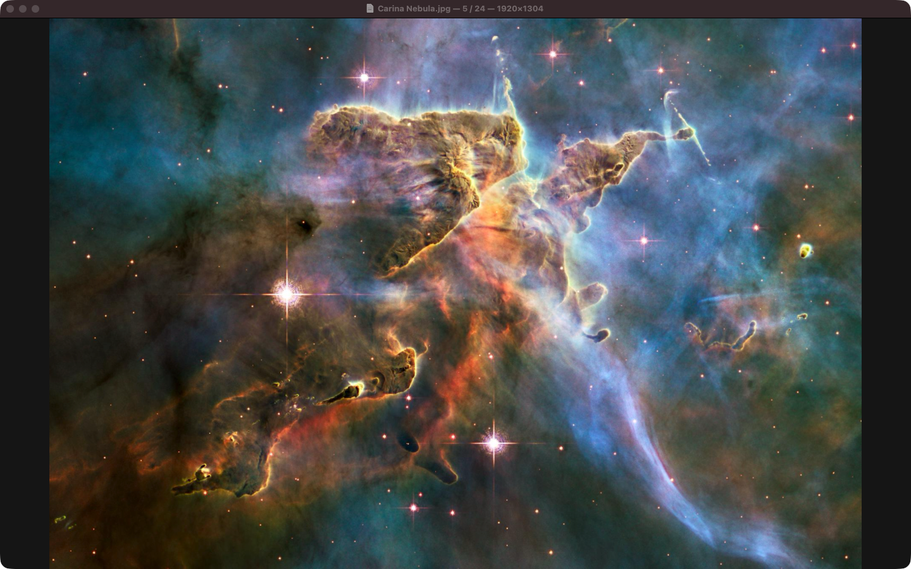
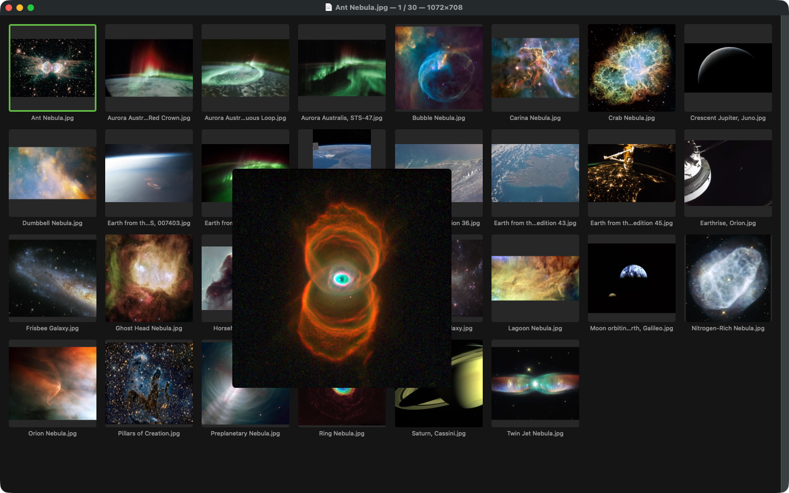
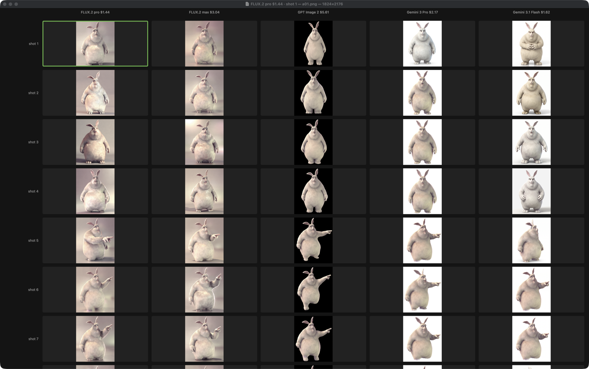

# glance

[](https://github.com/lockyc/glance/releases/latest)


[](LICENSE)

A fast, keyboard-driven image viewer for macOS. Open any image and ←/→ step instantly through
the rest of its folder; a full-window thumbnail grid, with an enlarged preview on hover, swaps
in for jumping around. It opens every image format macOS can decode, plus SVG. PDFs stay with
Preview. Turn on View → Include Subfolders for a folder and everything under it becomes one
stream, oldest first, with month headers in the grid — a whole screenshots archive browsed in
order. Hand it a handful of files and they open as a set; hand it labelled groups of files and
it lays the variants out side by side for comparing.

If you've used Xee, it's the same idea: arrow through a folder, as fast as the disk allows.
glance is free and open source.







<sub>Model renders adapted from Big Buck Bunny © Blender Foundation, [CC BY 3.0](https://creativecommons.org/licenses/by/3.0/).</sub>

## Install

Needs macOS 14+.

```bash
curl -fsSL https://raw.githubusercontent.com/lockyc/glance/main/install.sh | bash
glance --make-default   # optional: the default viewer for every image type except PDF
```

The installer downloads the latest release, checks that it is signed by glance's developer and
notarized by Apple, then installs `/Applications/glance.app` and links the `glance` command into
`~/.local/bin`, which must be on your PATH. After that glance updates itself: it checks daily,
and **glance → Check for Updates…** checks now. From a clone of this repo,
Claude Code's `/glance:install` runs the same install and checks the command works from a new
shell.

Or build from source, with the Xcode command-line tools (Swift 6) and
[`just`](https://github.com/casey/just):

```bash
git clone https://github.com/lockyc/glance && cd glance
just install        # builds glance.app into /Applications and links `glance` into ~/.local/bin
just make-default   # makes glance the default viewer for every image type except PDF
```

Opening a file shows it in its folder; opening a folder (or dropping one on the Dock icon)
opens the grid. A file anywhere inside a folder with Include Subfolders on opens that whole
tree, at that file. Individual subfolders can be excluded from the View → Subfolders submenu
or glance → Settings….

## Keys

**Viewer**

| Key | Action |
|---|---|
| ← / → | Previous / next image (wraps) |
| Home / End | First / last image |
| G or Space | Thumbnail grid |
| F or ⌃⌘F | Toggle full screen |
| Esc | Leave full screen |
| E or ⌘E | Edit in Excerpt (PNG only) |
| 0 / 1 | Fit to window / actual size |
| + / − | Zoom in / out |
| Pinch or ⌘-scroll | Zoom about the cursor |
| Drag, or scroll when zoomed | Pan |
| Double-click | Toggle fit ↔ actual size |

**Grid**

| Key | Action |
|---|---|
| ← / → | Select the previous / next tile (across months) |
| ↑ / ↓ | Move the selection by row |
| Return or click | Open the image |
| ⌘-click / ⇧-click | Select several tiles |
| E or ⌘E | Edit the selected images in Excerpt, as one series (PNG only) |
| Esc, G or Space | Back to the viewer |
| ⌘+ / ⌘− | Larger / smaller tiles (remembered) |
| Hover | Enlarged preview |

## Sets and comparisons

```bash
glance <folder>                                  # open a folder
glance <file>...                                 # open the files as a set
glance --variant <label> <file>... [--variant <label> <file>...]...
                                                 # compare labelled variants side by side
```

A set is just the files you name, in that order; it is never rescanned and Include Subfolders
doesn't apply. A comparison takes one or more `--variant` groups: each group is a column and each
file in it a row, so the first file of every variant sits on the first row (a shorter variant
leaves its remaining cells empty). Opening a cell keeps the grid's edges in view: every variant
along the top and every shot down the left, the current ones highlighted, and a map of the whole
grid in the corner; click a label or a map cell to jump there. View → Show Comparison Context hides
them (remembered). Every set or comparison opens in a new window; a single
folder reuses its existing window.

**Comparison**

| Key | Action |
|---|---|
| Arrows (grid) | Move the selection between cells |
| ← / → (viewer) | Same shot in the previous / next variant |
| ↑ / ↓ (viewer) | Previous / next shot in the same variant |
| Return or click | Open the cell in the viewer |
| Click a header or the map (viewer) | Open that cell |
| G / Space / Esc (grid) | Open the viewer on the current cell |
| G / Space (viewer) | Back to the grid |
| Esc (viewer) | Leave full screen, otherwise back to the grid |
| ⌘+ / ⌘− | Larger / smaller cells (remembered) |

## Formats

Everything ImageIO decodes — JPEG, PNG, HEIC/HEIF, WebP, AVIF, JPEG XL, TIFF, BMP, GIF, ICO,
ICNS, PSD, OpenEXR, TGA and camera RAW (CR2, CR3, NEF, ARW, RAF, ORF, DNG and more) — plus SVG.
Animated GIF, WebP and APNG play. A file that won't decode shows "Can't open" in place and
navigation carries on.

## Development

```bash
just test    # unit tests
just bench   # latency benchmarks
just run     # build the bundle and open it
```
